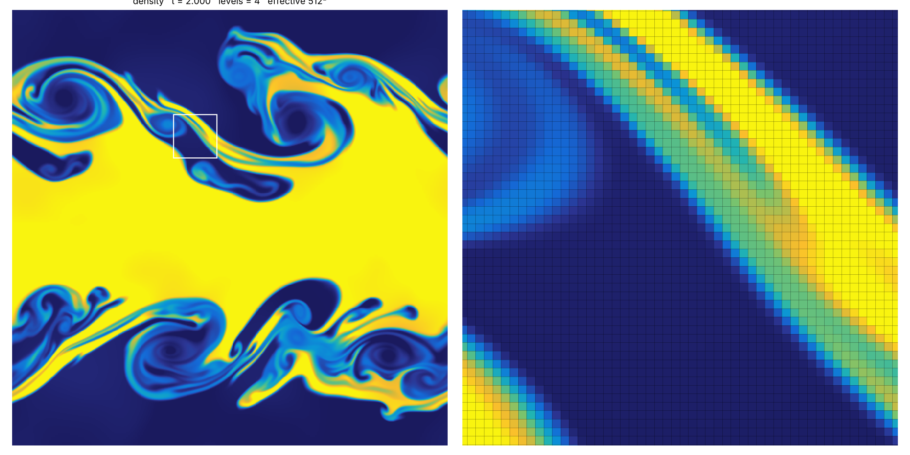

# kh_cns_fvm — Kelvin-Helmholtz instability with the AMReX CNS finite-volume solver

A self-contained 2D simulation of the Kelvin-Helmholtz instability using the
**AMReX CNS module** (compressible Navier-Stokes/Euler, `AmrLevel` driver)
with its **second-order finite-volume (FVM)** scheme and **adaptive mesh
refinement**. The production setup starts from a 64² base grid and refines by
six levels of factor 2 to an effective resolution of **4096²** cells. The
quantity shown is the (surface) density of the fluid.

The code layout follows
[sod-eb-stl](https://github.com/briandontloseyourheart-maker/sod-eb-stl):
`src/solver/` is the AMReX EB-CNS solver, unchanged apart from small
additions, and `src/problem/` holds the Kelvin-Helmholtz setup.

## Example result

64² base grid + 3 levels (512² effective), t = 2, density from 1 (dark blue)
to 2 (yellow); the right panel zooms on a filament with the AMR cells drawn.
Mass, momentum and energy stay constant to ~1e-15 (`docs/diagnostics_512.csv`).
Run with `inputs/kh_4096.inputs amr.max_level=3 stop_time=2` (≈25 min on one core).



## Build

Requirements: C++17 compiler, CMake ≥ 3.20, Python 3 (tests/plots), and an
AMReX checkout (pinned commit below).

```bash
git clone https://github.com/AMReX-Codes/amrex.git
git -C amrex checkout 2399452da8054029a92c5309a4bccb3102c109fd
git clone https://github.com/briandontloseyourheart-maker/instability.git
cd instability/20261024-1644_kh_cns_fvm
cmake -S . -B build -DCMAKE_BUILD_TYPE=Release -DAMREX_SOURCE_DIR=$PWD/../../amrex
cmake --build build -j 8
ctest --test-dir build --output-on-failure
```

An installed 2D AMReX with `AMReX_EB=ON` and `AMReX_AMRLEVEL=ON` also works:
`-DAMReX_DIR=<prefix>/lib/cmake/AMReX`.

## Run

```bash
mkdir -p runs/test && cd runs/test
OMP_NUM_THREADS=4 ../../build/bin/kh_cns ../../inputs/kh_test.inputs
python3 ../../tools/plot_kh.py plt00050 --zoom 0.5 0.75 0.1 --grid
```

| inputs file | grid | purpose |
|---|---|---|
| `inputs/kh_test.inputs` | 64² + 2 levels (256² effective), t ≤ 0.2 | quick check |
| `inputs/kh_4096.inputs` | 64² + 6 levels (**4096² effective**), t ≤ 3 | full simulation (workstation/cluster) |

Parameters can be overridden on the command line, e.g. `amr.max_level=4 stop_time=1.5`.

Output: `pltNNNNN/` plotfiles (`density`, momenta, energy, `pressure`,
velocities; readable with ParaView/VisIt/yt or `tools/plot_kh.py`),
optional `chkNNNNN/` checkpoints, and `diagnostics.csv` with composite mass,
momentum, energy, density/pressure extrema and cells per level for every
coarse step.

## Physical setup

Doubly periodic unit square, ideal gas γ = 5/3, inviscid:
ρ = 2, vₓ = +0.5 for 0.25 < y < 0.75 and ρ = 1, vₓ = −0.5 elsewhere, p = 2.5,
interfaces smoothed with tanh of width `prob.delta`; seed
v_y = w₀ sin(4πx)[exp(−(y−0.25)²/2σ²) + exp(−(y−0.75)²/2σ²)], w₀ = 0.1,
σ = 0.05/√2, plus optional multi-mode noise (`prob.noise_*`).

## Numerical method (AMReX CNS)

* finite-volume MUSCL scheme: characteristic piecewise-linear reconstruction
  with the monotonized-central limiter (CNS defaults), Riemann solver at faces;
* 2-stage Runge-Kutta (RK2) time stepping, `cns.cfl`;
* Berger–Oliger AMR with subcycling, refluxing for conservation, regridding
  where the density jump between neighbouring cells exceeds `cns.refine_dengrad`;
* the EB machinery is compiled in but the geometry is `all_regular`.

## Layout

```text
├── CMakeLists.txt
├── inputs/        kh_test.inputs, kh_4096.inputs
├── src/
│   ├── main.cpp, diagnostics.*   driver and conservation diagnostics
│   ├── solver/                   AMReX CNS (finite volume, AmrLevel)
│   └── problem/                  Kelvin-Helmholtz initial condition, prob.* parameters
├── tools/         plotfile reader + density plot with zoomed AMR grid
└── tests/         CTest smoke test (conservation, positivity, refinement)
```

AMReX (and the CNS solver taken from it) is distributed under its own license,
see `LICENSE-AMReX`.
