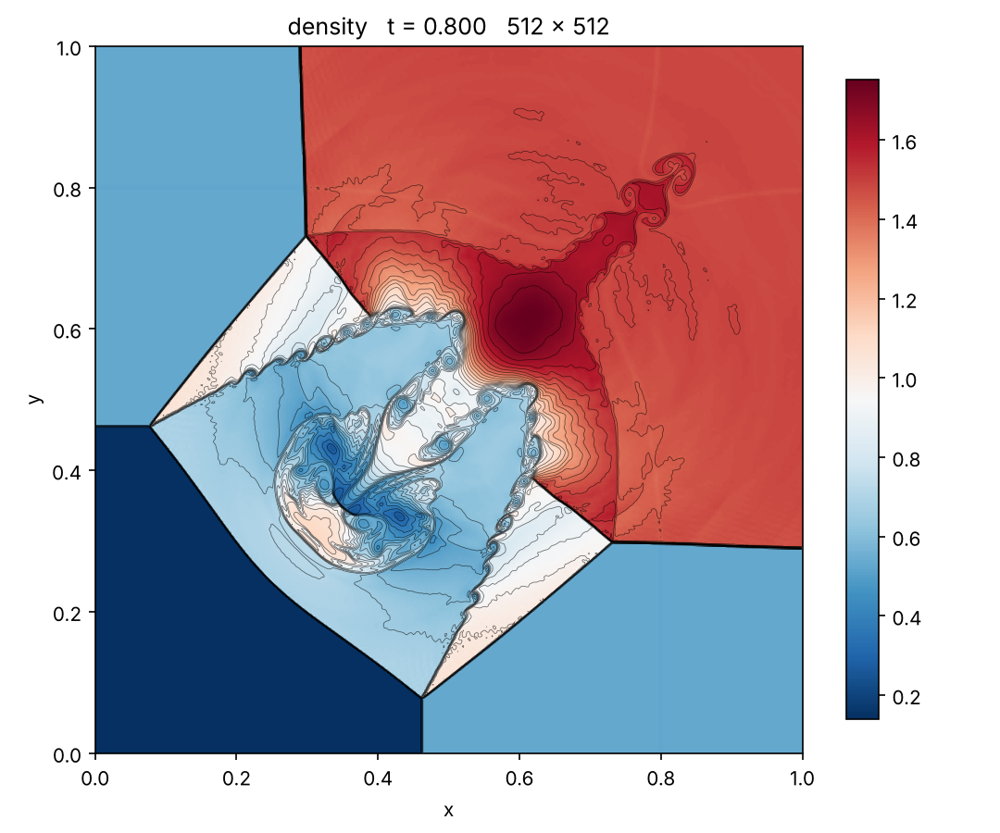

# riemann2d_weno7: 2D Riemann problem with Roe + WENO7 + SSPRK(10,4)

A self-contained 2D Euler simulation of the four-quadrant **Riemann problem,
configuration 3** (Lax & Liu 1998) on a **2048 × 2048** grid. It is built on the
**AMReX CNS module** (`AmrLevel` driver), with a high-order finite-volume scheme
added to it:

* **WENO7** reconstruction (7th order, Balsara & Shu 2000, WENO-Z weights by
  default) carried out in **characteristic variables**;
* **Roe** approximate Riemann solver with Harten's entropy fix;
* **SSPRK(10,4)** time integration: Ketcheson's 10-stage, 4th-order,
  low-storage strong-stability-preserving Runge-Kutta method.

The layout follows
[sod-eb-stl](https://github.com/briandontloseyourheart-maker/sod-eb-stl).
`src/solver/` is the AMReX EB-CNS solver plus the new scheme, and
`src/problem/` holds the Riemann setup.

## Example result



The demo above is 512² at t = 0.8: density in a red-blue map, with 30
contour lines. The production run is the same setup on 2048²
(`inputs/rp2d_2048.inputs`). That run needs a workstation or cluster, because
the cost grows as N³ (roughly 8× per doubling of the grid).

## Build

Requirements:

* a C++17 compiler;
* CMake ≥ 3.20;
* Python 3 with numpy and matplotlib, for the tests and plots;
* an AMReX checkout at the pinned commit shown below.

```bash
git clone https://github.com/AMReX-Codes/amrex.git
git -C amrex checkout 2399452da8054029a92c5309a4bccb3102c109fd
git clone https://github.com/briandontloseyourheart-maker/instability.git
cd instability/20261024-1802_riemann2d_weno7
cmake -S . -B build -DCMAKE_BUILD_TYPE=Release -DAMREX_SOURCE_DIR=$PWD/../../amrex
cmake --build build -j 8
ctest --test-dir build --output-on-failure
```

An installed 2D AMReX built with `AMReX_EB=ON` and `AMReX_AMRLEVEL=ON` also
works: pass `-DAMReX_DIR=<prefix>/lib/cmake/AMReX` instead.

## Run

```bash
mkdir -p runs/test && cd runs/test
OMP_NUM_THREADS=4 ../../build/bin/riemann2d ../../inputs/rp2d_test.inputs
python3 ../../tools/plot_riemann.py            # newest plotfile here: density + contours (RdBu_r)
python3 ../../tools/plot_riemann.py plt00100   # or a specific plotfile
```

| inputs file | grid | purpose |
|---|---|---|
| `inputs/rp2d_test.inputs` | 256², t ≤ 0.8 | quick run (minutes) |
| `inputs/rp2d_2048.inputs` | **2048² uniform**, t ≤ 0.8 | production run, with checkpoints every 0.2 |
| `inputs/rp2d_amr_2048.inputs` | 256² + 3 AMR levels (2048² effective) | cheaper alternative that refines only at shocks and contacts |

Any parameter can be overridden on the command line, for example
`amr.n_cell="1024 1024" stop_time=0.5`. To restart from a checkpoint, add
`amr.restart=<checkpoint>` with the name of an existing
`chkNNNNN` directory, e.g. `amr.restart=chk00400`.

The run writes:

* `pltNNNNN/` plotfiles, with density, momenta, energy, `pressure` and
  velocities. ParaView, VisIt, yt or `tools/plot_riemann.py` can read them.
* `chkNNNNN/` checkpoints.
* `diagnostics.csv`, with mass, momentum, energy and the density and pressure
  extrema for every step.

## Parallel runs with MPI

The default build uses OpenMP only. For MPI, install an MPI library first, for
example `sudo apt install libopenmpi-dev openmpi-bin` on Ubuntu. Then configure
a separate build directory with `-DRP2D_USE_MPI=ON`:

```bash
cmake -S . -B build-mpi -DCMAKE_BUILD_TYPE=Release -DAMREX_SOURCE_DIR=$PWD/../../amrex -DRP2D_USE_MPI=ON
cmake --build build-mpi -j 8
```

Run with `mpiexec`, either one rank per core or MPI ranks combined with OpenMP
threads:

```bash
mkdir -p runs/mpi && cd runs/mpi
OMP_NUM_THREADS=1 mpiexec -n 8 ../../build-mpi/bin/riemann2d ../../inputs/rp2d_2048.inputs
# hybrid: 4 ranks x 2 threads
OMP_NUM_THREADS=2 mpiexec -n 4 ../../build-mpi/bin/riemann2d ../../inputs/rp2d_2048.inputs
```

Each rank works on a share of the grid boxes, so give every rank several boxes.
Lower `amr.max_grid_size` if there are more ranks than boxes. Plotfiles are
written in parallel (`Level_0/Cell_D_00000`, `Cell_D_00001`, …), and the plot
scripts read them as usual. With an installed AMReX (`-DAMReX_DIR=…`), MPI is
on only if that AMReX was built with `AMReX_MPI=ON`. When running as root,
OpenMPI also needs `--allow-run-as-root`.

## Physical setup

* Unit square with outflow (zero-gradient) boundaries.
* Ideal gas, γ = 1.4.
* The square is split at (x₀, y₀) = (0.8, 0.8) into four quadrants:

| quadrant | ρ | u | v | p |
|---|---|---|---|---|
| upper right | 1.5 | 0 | 0 | 1.5 |
| upper left | 0.5323 | 1.206 | 0 | 0.3 |
| lower left | 0.138 | 1.206 | 1.206 | 0.029 |
| lower right | 0.5323 | 0 | 1.206 | 0.3 |

The four interfaces are shocks. Their interaction drives the mushroom-shaped
jet along the diagonal. All values come from `prob.*` in the inputs files.

Each cell gets the exact average of 4 × 4 sub-samples. The quadrant states are
summed in an order that keeps the data **bitwise symmetric about x = y**, and
the solver keeps that symmetry exactly.

## Numerical method

**Spatial discretization** (`src/solver/hydro/CNS_weno_roe_K.H`). For each face:

1. Roe-average the two neighbouring cells and build the eigenvectors of the
   flux Jacobian normal to the face.
2. Project the 8 surrounding cells onto characteristic variables.
3. Apply WENO7 to get the left and right face states.
4. Transform back and evaluate the Roe flux.

If a reconstructed state has non-positive density or pressure, that face falls
back to first order. Select the
scheme with `cns.hydro_scheme`: 1 is WENO7-Roe and 0 is the original CNS
MUSCL scheme. `cns.weno_z = 0` switches to classic WENO-JS weights.

**Time integration** (`src/solver/CNS_advance.cpp`, `cns.rk_scheme = 104`) uses
Ketcheson's SSPRK(10,4) in its two-register low-storage form. Stages 1 to 5 are
forward-Euler steps of dt/6. Then the registers are mixed: q₂ ← q₂/25 + 9q₁/25
and q₁ ← 15q₂ − 5q₁. Stages 6 to 9 are again steps of dt/6, and the last line
is u ← q₂ + 3q₁/5 + dt·L(q₁)/10. Every stage has weight 1/10, which is also what
the AMR flux registers accumulate. The SSP coefficient is 6, so
`cns.cfl = 1.5` is a per-stage CFL of 0.25. Ghost cells are refilled before
every stage. `cns.rk_scheme = 2` restores the original RK2.

## Verification (`ctest`)

`tests/smoke_test.py` checks two things:

1. **Order of accuracy.** It advects a smooth density wave on periodic 32² and
   64² grids and compares against the exact cell averages. The measured order
   is **4.11**: the 4th-order time integrator dominates, while WENO7 is 7th
   order in space.
2. **Configuration 3** on 128² up to t = 0.3. Density and pressure stay
   positive, and the solution is exactly symmetric about x = y (the measured
   asymmetry is 0).

## Layout

```text
├── CMakeLists.txt
├── inputs/        rp2d_test, rp2d_2048 (uniform), rp2d_amr_2048 (AMR)
├── src/
│   ├── main.cpp, diagnostics.*      driver and per-step diagnostics
│   ├── solver/                      AMReX CNS + WENO7/Roe kernel + SSPRK(10,4)
│   └── problem/                     four-quadrant initial data, prob.* parameters
├── tools/         plotfile reader and density plot
├── tests/         CTest smoke test (order of accuracy, positivity, symmetry)
└── docs/          example images
```

AMReX, and the CNS solver taken from it, is distributed under its own license.
See `LICENSE-AMReX`.
